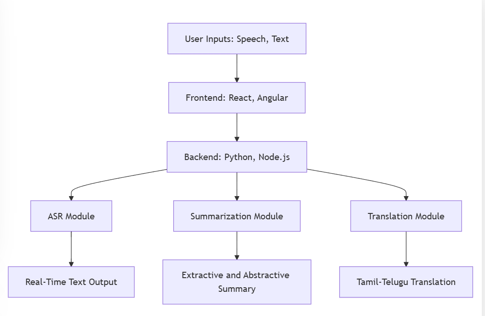
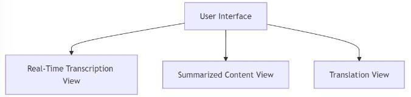
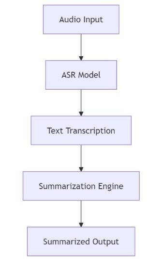
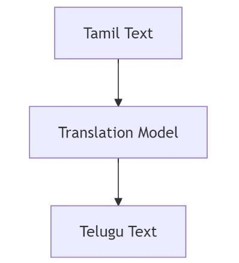

# Multilingual Meeting Summarizer — Design Study

**Tamil · Telugu · ASR · Summarization · Translation · Software engineering**

A September 2024 proposal for helping Tamil- and Telugu-speaking participants follow multilingual meetings through transcripts, summaries, and translated text.

*Archived requirements/design study · Not actively maintained*

## Proposed architecture

Diagram extracted from the recovered software-engineering report. It describes a proposed architecture; it does not establish a working implementation.

## Intended experience

- Accept meeting audio and supporting chat/text notes.
- Transcribe Tamil and Telugu speech.
- Offer extractive or abstractive summaries, with brief/detailed output options.
- Translate between Tamil and Telugu.
- Present transcript, summary, and translation views.

## Workflows from the report

| Transcription and summarization | Tamil-to-Telugu translation |
| --- | --- |
|  |  |

## Candidate technology choices

The proposal considers Whisper/cloud ASR, BART/Pegasus/mT5-family summarization, IndicTrans/mT5 translation, React/Angular interfaces, and Python/Node.js services. These are proposed alternatives, not a recovered dependency lockfile or verified production stack.

Read [DESIGN_NOTES.md](DESIGN_NOTES.md) for requirements, scope, and the relationship to other coursework.

## What was recovered

A problem-definition/objectives report, proposed workflows, and architecture diagrams. No matching application source, trained model, meeting transcript, deployment, or measured evaluation was found in this semester folder. There is no runnable installation command for this design archive.

This study is distinct from the existing Tamil text-summarization experiments, Tamil-to-Telugu speech-translation prototype, and Phase 2 Malayalam summarization project. The raw report cover, team names, student IDs, and activity log are excluded from the public showcase.
